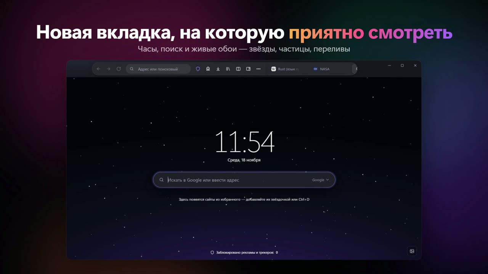
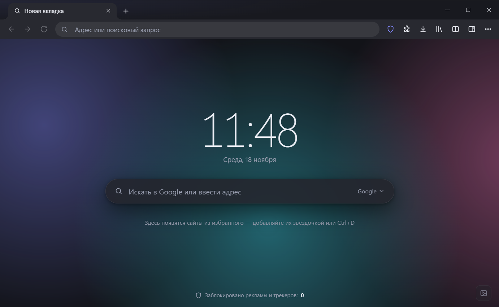
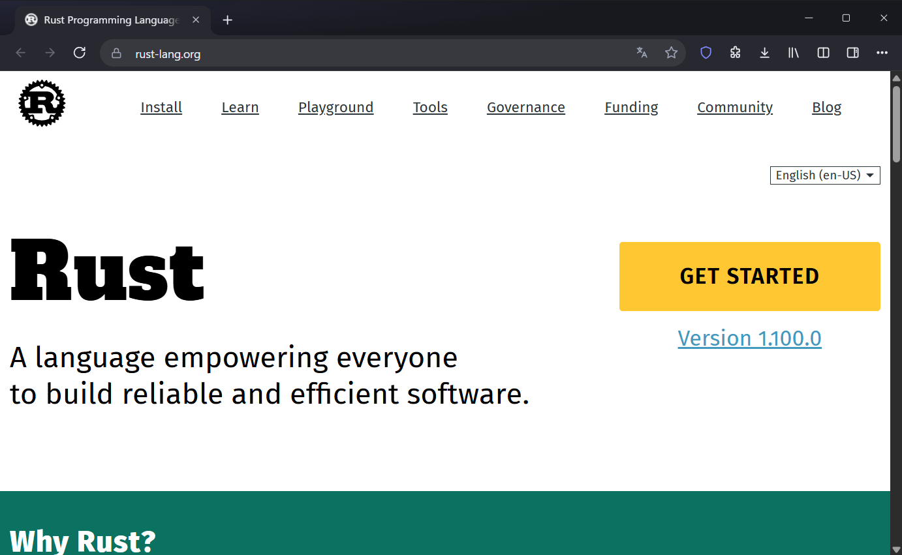

<div align="center">


# Rust Browser

**Лёгкий браузер для Windows и Android с интерфейсом в виде плавающего «острова»**


</div>

<p align="center">
  <a href="promo/rust-browser-promo.mp4"></a><br>
  <sub>▶ <a href="promo/rust-browser-promo.mp4">Промо-ролик</a> · 1:16</sub>
</p>

<p align="center">
  
  
</p>

---

## ✨ Возможности

| | |
|---|---|
| 🏝️ **Остров** | плавающая панель с адресной строкой, прячется при прокрутке; режимы «только сайт» и «компакт», вертикальные вкладки |
| 🗂️ **Вкладки** | группы вкладок, разделённый экран, значки сайтов |
| 🛡️ **Блокировка** | встроенный uBlock Origin Lite и собственный список блокировки |
| 🌙 **Внешний вид** | тёмная тема для сайтов (уже тёмные не портит), «бусты» — свой вид для каждого сайта |
| 🔐 **Приватность** | менеджер паролей и карт с шифрованием, проверка паролей на утечки, автозаполнение |
| ⌨️ **Удобство** | редактор горячих клавиш, поиск по клавишам, перевод страниц, картинка в картинке |
| 🔄 **Синхронизация** | закладки и история между Windows и Android через зашифрованный файл в облачной папке (например, OneDrive) |

## 🚀 Сборка

### Windows

Нужны [Rust](https://rustup.rs) (stable) и WebView2 Runtime.

```powershell
cargo build --release
```

Готовый файл: `target/release/rust-browser.exe`.

### Android

Нужны JDK и Android SDK. Сборка подписывается локальным ключом `android/rustbrowser.keystore`, в репозитории его нет: создайте свой с тем же именем или поправьте `signingConfigs` в `android/app/build.gradle.kts`.

```powershell
.\android\build.ps1
```

Скрипт рассчитан на мои пути (`D:\Android`), поправьте их под себя.

## 🧪 Проверки

```powershell
cargo test
```

Сквозные проверки браузера описаны в [`tests/e2e/README.md`](tests/e2e/README.md).

## 🧱 Устройство

| Путь | Что там |
|---|---|
| `src/` | десктопный браузер на Rust: окно (`tao` + `wry`), WebView2, блокировщик, пароли, синхронизация |
| `src/ui/` | интерфейс острова и страниц |
| `android/` | версия для Android (Kotlin, Jetpack Compose) |
| `assets/` | иконки и скрипты их генерации |
| `tests/e2e/` | сквозные проверки |

## 📄 Лицензия

[MIT](LICENSE)
